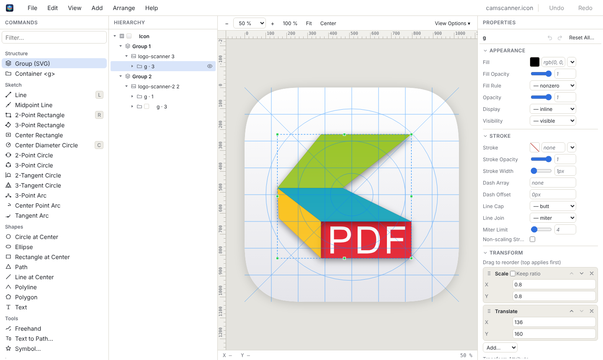
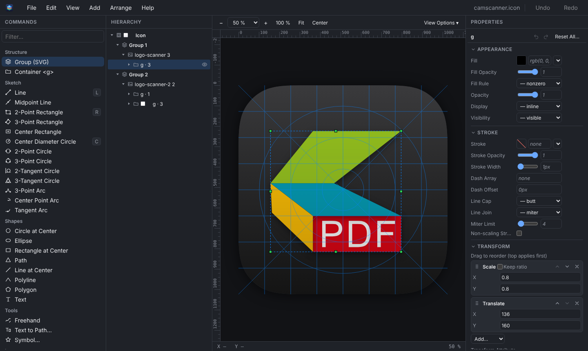
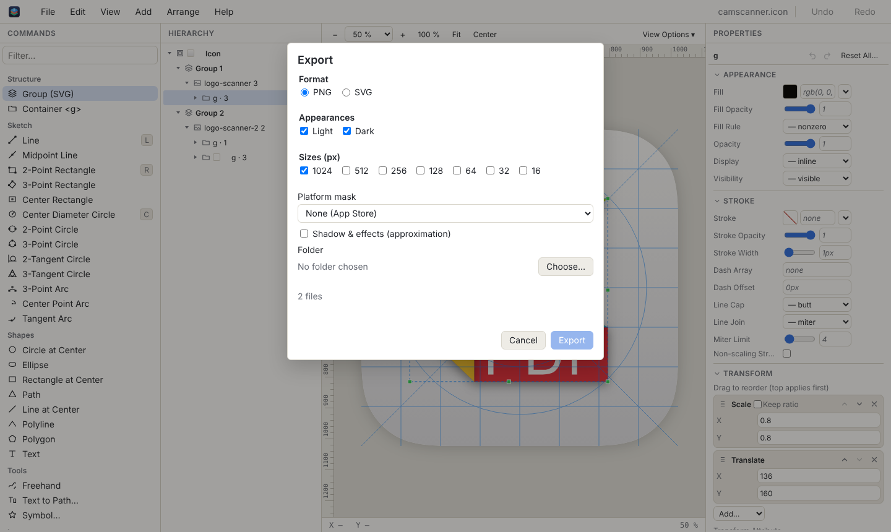

# AppIconic


A desktop editor for app icons in Apple's **`.icon`** format (Icon Composer): groups and layers of SVG artwork,
background fills, shadows and translucency, with export to SVG and PNG – for macOS, Windows and Linux.

Built with **Tauri 2 + Angular 22 (zoneless, Signals) + Rust**. The SVG document lives in the WebView's DOM (the
browser renders, parses and measures); Rust handles files, `.icon` bundles and ZIP, PNG export and fonts.



<details>
<summary>Dark appearance and the export dialog</summary>




</details>

> Status: the checklist [docs/FEATURES.md](docs/FEATURES.md) is done except a gradient editor (parity with the original app:
> [docs/parity.md](docs/parity.md)); roadmap and open prompts in [prompts/README.md](prompts/README.md).

**What it does:** open and save `.icon` files (bundle or ZIP) without losing unknown fields; groups, layers and their
SVG assets in a hierarchy; select, move, scale and edit points on the canvas with grid and magic snap; sketch tools
like Fusion (lines, rectangles, circles and arcs with typed dimensions); properties of every SVG element and of the
icon (fill, shadow, translucency, platforms, appearances); clip paths, freehand, text to path, Lucide symbols;
“Edit SVG…” with a code editor; export to PNG (resvg) and SVG.

The UI speaks English and German (switchable at runtime), light and dark. Settings (⌘, / Ctrl+,) are kept in
`settings.json`, your own shortcuts in `keymap.json` – both in the app's config folder.

**AI control (MCP):** an assistant such as Claude Code or Claude Desktop can drive a running AppIconic – create and
open icons, add shapes, set the background, look at a preview, export – through the same actions as menus and
keyboard, each AI step one undo step. Off by default; set up in Settings → AI control, see [docs/mcp.md](docs/mcp.md).

## Development

Requirements: Node ≥ 22.22.3, pnpm 10, Rust stable ≥ 1.93, and the
[Tauri prerequisites](https://tauri.app/start/prerequisites/) of your OS.

```sh
pnpm install
pnpm tauri dev      # app with hot reload (dev server on port 1450)
pnpm start          # frontend only, in the browser (fake backend with a sample .icon in memory)
pnpm test           # unit tests (Vitest)
pnpm e2e            # end-to-end tests (Playwright; once: pnpm e2e:install)
pnpm check          # format, lint, tests, build, cargo fmt/clippy/test
pnpm tauri build    # release bundle
```

Architecture and decisions: [docs/architecture.md](docs/architecture.md). Rules for contributors (and Claude):
[CLAUDE.md](CLAUDE.md).

## License

MIT © 2026 Marc Kronberg. Third-party works (the Lucide icons of the symbol picker, ISC/MIT):
[THIRD-PARTY-NOTICES.txt](THIRD-PARTY-NOTICES.txt).
