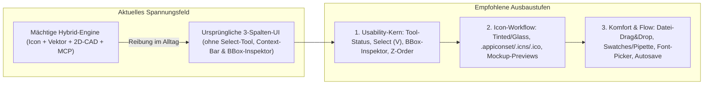

# Produkt-, Feature- & Usability-Analyse: AppIconic

**Stand der Analyse:** 30. Oktober 2026  
**Untersuchte Codebasis:** `app-iconic` (Tauri 2 · Angular 22 Zoneless/Signals · Rust `ai-core` & `ai-mcp`, Stand nach Prompt 060)

---

## Executive Summary

**AppIconic** besitzt ein außergewöhnlich starkes technisches Fundament: Die Entscheidung *„Der Browser ist die Grafik-Engine“* (echte SVG-DOM-Geometrie über `getScreenCTM`/`DOMMatrix`, Shadow-DOM-Isolation pro Layer, verlustfreier Byte-Roundtrip für `.icon`-Bundles und ZIPs, atomares Speichern) vermeidet klassische Rendering- und Transformationsfehler eigener Parser. Hinzu kommen vorbildliche Barrierefreiheit (WAI-ARIA APG), Laufzeit-Mehrsprachigkeit (DE/EN), geprüfte Light/Dark-Kontraste und eine durchgängige Action-/Command-Architektur inklusive **MCP-KI-Steuerung**, bei der jeder KI-Eingriff exakt ein Undo-Schritt ist.

> [!IMPORTANT]
> **Kernbefund (Die Schere zwischen Engine und UI):** Zwischen Prompt `001` und `060` ist AppIconic funktional von einem schlanken `.icon`-Inspektor zu einem **vollwertigen Hybrid aus Vektor-Illustrationsprogramm (VectorCraft/Illustrator) und parametrischem 2D-CAD-Sketcher (Fusion 360)** mit über 150 Aktionen und rund 25 interaktiven Werkzeugen gewachsen – steckt visuell und konzeptionell aber noch im ursprünglichen **3-Spalten-Layout aus Prompt `005`/`008`**. Die größten Hebel liegen daher nicht im Hinzufügen weiterer Geometrie-Algorithmen, sondern in **Werkzeug-Klarheit, Bounding-Box-Kontrolle, Icon-spezifischen End-to-End-Workflows (iOS 18+/macOS Liquid Glass, AppIconset-Export) und direkter Manipulation**.

---

## 1. Welche Features fehlen?

### 1.1 Apple `.icon`-Ökosystem & Export-Workflows (Kern-Domäne)

1. **Vorschau & Export für `Tinted` und `Clear` Appearances (iOS 18+ / macOS Tahoe)**
  - Im [`icon-inspector.html`](file:///Users/marckronberg/WebstormProjects/app-iconic/src/app/features/inspector/icon-inspector.html#L1-L17) lassen sich `tinted`-Specializations zwar anlegen, es erscheint jedoch lediglich der Hinweis *„not previewed“*.
  - Weder die Canvas-Vorschau ([`appearance.ts`](file:///Users/marckronberg/WebstormProjects/app-iconic/src/app/features/canvas/appearance.ts)) noch der Export ([`export-options.ts`](file:///Users/marckronberg/WebstormProjects/app-iconic/src/app/features/export/export-options.ts#L11)) unterstützen `tinted` (Luminanz-Monochrom + Tint-Farbe) oder `clear`/glasige Systemvarianten.

2. **Entwicklerfertige Export-Formate & Bundles statt nur flacher Einzeldateien**
  - Aktuell schreibt [`ExportDialog`](file:///Users/marckronberg/WebstormProjects/app-iconic/src/app/features/export/export-dialog.ts) ausschließlich lose `.png`- (16–1024 px) oder `.svg`-Dateien in einen Zielordner.
  - Für den direkten Einsatz in Apps fehlen:
    - **Xcode `AppIcon.appiconset`-Export** (Ordnerstruktur inkl. fertiger `Contents.json` für Light, Dark, Tinted, macOS-Größen & watchOS).
    - **macOS `.icns`** und **Windows `.ico`** Container-Dateien (besonders naheliegend, da AppIconic selbst Cross-Platform für macOS, Windows und Linux ausgeliefert wird).
    - **Android Adaptive Icons** (`foreground` / `background` / `monochrome` getrennt exportieren – die Gruppen-/Ebenen-Architektur von `.icon` passt hierfür ideal) sowie **Web / PWA Icon-Pakete** (`favicon.ico`, `apple-touch-icon.png`, `manifest.webmanifest`, responsives Dark-Mode-Favicon-SVG).
    - **1-Klick „Quick Export“ / „Copy PNG to Clipboard“** (z. B. `⇧⌘C`, um das gerenderte Icon sofort in Slack, GitHub-PRs, Figma oder Präsentationen einzufügen).

3. **Fehlende Darstellung editierbarer `.icon`-Eigenschaften (Liquid Glass & Layer-Fill)**
  - Im [`icon-fields.ts`](file:///Users/marckronberg/WebstormProjects/app-iconic/src/app/features/inspector/icon-fields.ts#L119-L228) kann der Nutzer Group-`lighting`, `specular`, `blur-material` sowie Layer-`glass` und **Layer-`fill`** bearbeiten. In [`effects.ts`](file:///Users/marckronberg/WebstormProjects/app-iconic/src/app/features/canvas/effects.ts), [`layer-stack.ts`](file:///Users/marckronberg/WebstormProjects/app-iconic/src/app/features/canvas/layer-stack.ts) und [`export-svg.ts`](file:///Users/marckronberg/WebstormProjects/app-iconic/src/app/features/export/export-svg.ts) werden diese Felder jedoch **komplett ignoriert**.
  - Insbesondere **Layer-`fill`** (in Apples Icon Composer essenziell, um einfarbige SVG-/PNG-Maskenlayer einzufärben) hat keinerlei visuelle Auswirkung; ebenso gibt [`blendCss()`](file:///Users/marckronberg/WebstormProjects/app-iconic/src/app/features/canvas/effects.ts#L32-L34) für den im Inspector wählbaren Modus `plus-darker` `null` zurück.
  - **Hintergrund `radial-gradient`**: [`fill-preview.ts`](file:///Users/marckronberg/WebstormProjects/app-iconic/src/app/features/canvas/fill-preview.ts#L88-L105) kann radiale Hintergrundverläufe lesen und rendern, aber [`fill-model.ts`](file:///Users/marckronberg/WebstormProjects/app-iconic/src/app/features/inspector/fill-model.ts#L36-L42) verbietet das Neuanlegen im UI.

4. **Kontext-Mockups (Real-World Icon Previews)**
  - [`SmallPreview`](file:///Users/marckronberg/WebstormProjects/app-iconic/src/app/features/preview/small-preview.ts) zeigt 16/32/64/128 px in der Ecke, aber Icon-Designer beurteilen Icons im Kontext: **macOS Dock** zwischen Nachbar-Icons, **iOS Home Screen** vor hellem/dunklem Wallpaper, **Spotlight / Notification-Banner** und **Windows Taskleiste**.

5. **PNG-Layer-Import & Transformation auf dem Canvas**
  - Vorhandene `Assets/*.png` werden verlustfrei durchgereicht, aber es gibt **keinen „Import PNG as Layer…“-Befehl** (`File › Import SVG…` akzeptiert nur `.svg`; `Add › Image…` bettet ein `<image data:...>` *innerhalb* eines SVG-Assets ein). Zudem lassen sich reine PNG-Layer nicht per Maus auf dem Canvas greifen oder skalieren, sondern nur über Zahlenfelder (`position`) im Inspector.

---

### 1.2 Farbe, Effekte & Typografie

6. **Pipette (Eyedropper), Farbfelder (Swatches) & Dokumentpalette**
  - [`ColorField`](file:///Users/marckronberg/WebstormProjects/app-iconic/src/app/shared/controls/color-field.ts) besteht nur aus nativem `<input type="color">`, Hex-Textfeld und Keyword-Dropdown.
  - Es fehlen:
    - **Canvas-Pipette** zum Aufnehmen von Farben direkt von Elementen, Verläufen oder importierten Bildern.
    - **Dokumentfarben (Used Colors)** – automatisch alle im Icon verwendeten Farben als klickbare Swatches anzeigen (inkl. globalem *„Farbe im ganzen Icon ersetzen“*).
    - **Eigene Farbpaletten / Zuletzt verwendete Farben** sowie ein direkter **Deckkraft-/Alpha-Regler** im Farbwähler und moderne Farbräume (**HSL / HSB / OKLCH**).

7. **Visuelle Editoren für Element-Schatten, Unschärfe, Masken & Blend-Modes**
  - Der SVG-Sanitizer erlaubt `<filter>`, `feDropShadow`, `feGaussianBlur` und `<mask>`, aber im Properties-Panel ([`property-defs.ts`](file:///Users/marckronberg/WebstormProjects/app-iconic/src/app/features/properties/property-defs.ts#L282-L283)) sind `filter` und `mask` bloße Rohtextfelder unter `Advanced` (`url(#...)`).
  - Ein visueller **Effekt-Abschnitt pro SVG-Element** (Drop Shadow, Inner Shadow, Layer Blur, `mix-blend-mode`) sowie ein analoger Workflow zu `Clip Path` für **Luminanz-/Alpha-Masken (`<mask>`)** fehlen.

8. **Vollwertige Live-Typografie (`<text>`)**
  - Während [`TextPathDialog`](file:///Users/marckronberg/WebstormProjects/app-iconic/src/app/features/tools/text-path-dialog.ts) einen durchsuchbaren Systemschriften-Katalog aus Rust (`list_fonts`) bietet, ist `font-family` bei regulären `<text>`-Elementen im Properties-Panel ([`property-defs.ts`](file:///Users/marckronberg/WebstormProjects/app-iconic/src/app/features/properties/property-defs.ts#L253)) nur ein ungestütztes Freitextfeld.
  - Es fehlen: **Doppelklick zum direkten Editieren von Text auf dem Canvas**, Font-Dropdown + Schriftschnitt (`font-style: italic`), `letter-spacing`, `line-height`, Mehrzeiligkeit sowie eine Aktion **„Text in Pfad umwandeln“** für bestehende `<text>`-Nodes unter Nutzung von Rusts `harfrust`/`skrifa`-Shaping.

---

### 1.3 Datei-Handling, Sicherheit vor Datenverlust & Onboarding

9. **Drag & Drop von Dateien in das Fenster + Bild-Zwischenablage**
  - [`src-tauri/src/lib.rs`](file:///Users/marckronberg/WebstormProjects/app-iconic/src-tauri/src/lib.rs#L81-L108) ignoriert `WindowEvent::DragDrop`. Das Ziehen einer `.icon`-, `.svg`- oder `.png`-Datei aus Finder/Explorer in das App-Fenster bewirkt nichts.
  - [`ClipboardApi`](file:///Users/marckronberg/WebstormProjects/app-iconic/src/app/core/clipboard/clipboard-api.ts) liest nur Text (`navigator.clipboard.readText()`), sodass kopierte Rasterbilder/Screenshots nicht mit `⌘V` eingefügt werden können.

10. **Autosave / Crash-Recovery**
  - Ungespeicherte Dokumente existieren ausschließlich im Speicher der WebView ([`DocumentStore`](file:///Users/marckronberg/WebstormProjects/app-iconic/src/app/features/document/document.store.ts)). Ein periodisches Recovery-Snapshot-Journal im App-Config-Verzeichnis schützt vor Datenverlust bei Abstürzen oder Stromausfall.

11. **Startbildschirm, Vorlagen-Galerie & Eigene Asset-/Symbol-Bibliothek**
  - Beim Start ohne Datei öffnet [`FilesService.start()`](file:///Users/marckronberg/WebstormProjects/app-iconic/src/app/features/files/files.service.ts#L53-L60) sofort ein leeres Dokument. Ein optionaler **Welcome-Dialog / Start-Screen** mit *Zuletzt geöffneten Icons (inkl. Thumbnail!)* und **Starter-Templates** (iOS App-Icon mit Keylines, macOS Squircle + Schatten, watchOS Badge, Dual-Light/Dark-Vorlage) erleichtert den Einstieg erheblich.
  - Die vorhandene [`SymbolProvider`](file:///Users/marckronberg/WebstormProjects/app-iconic/src/app/features/symbols/symbol-provider.ts)-Schnittstelle sollte neben Lucide um weitere freie Sets (z. B. **Tabler**, **Phosphor**) und vor allem einen **„Eigene Symbole / Wiederverwendbare Formen“-Provider** ergänzt werden.

---

## 2. Was kann man für den User besser machen? (Konkrete Reibungspunkte & Bugs)

> [!WARNING]
> Die folgenden Punkte betreffen Funktionen, die **bereits in der App vorhanden sind**, im realen Arbeitsfluss aber zu Überraschungen, Sackgassen oder unerwarteten Ergebnissen führen.

### 2.1 Kein Bounding-Box-Inspektor (`X`, `Y`, `B`, `H`, `Rotation`) bei Pfaden, Gruppen & Mehrfachauswahl
- **Befund:** [`property-spec.ts`](file:///Users/marckronberg/WebstormProjects/app-iconic/src/app/features/properties/property-spec.ts#L36-L78) erzeugt Geometriefelder strikt aus rohen SVG-Attributen, und [`commonSpec()`](file:///Users/marckronberg/WebstormProjects/app-iconic/src/app/features/properties/property-spec.ts#L98-L102) bildet bei Mehrfachauswahl die Schnittmenge.
- **Folge für den User:**
  - Ist eine Gruppe `<g>` ausgewählt (gut sichtbar in [`docs/screenshots/editor-light.png`](file:///Users/marckronberg/WebstormProjects/app-iconic/docs/screenshots/editor-light.png)), gibt es **überhaupt keinen Geometrie-Abschnitt**!
  - Ist ein `<path>` ausgewählt, sieht der User unter Geometrie nur ein Textfeld mit rohem Pfadcode (`d="M 120 340 C ..."`).
  - Sind ein `<rect>` und ein `<circle>` gemeinsam markiert, verschwinden alle Positions- und Größenfelder.
- **Verbesserung:** Ganz oben im Properties-Panel sollte **immer** ein berechneter **Transform-/Bounding-Box-Kopf** stehen (`X`, `Y`, `Breite`, `Höhe` mit Proportionen-Schloss, `Rotation °`, `Horizontal/Vertikal spiegeln`), gemessen im Dokumentraum (1024 × 1024), der jede beliebige Einzel- oder Mehrfachauswahl präzise numerisch positioniert und skaliert.

### 2.2 Invertierte Z-Reihenfolge innerhalb desselben Hierarchie-Baums
- **Befund:** In [`hierarchy-model.ts`](file:///Users/marckronberg/WebstormProjects/app-iconic/src/app/features/hierarchy/hierarchy-model.ts#L102-L162) stehen bei Icon-Gruppen und Layern die **vordersten Ebenen oben** (Index 0 = vorne, wie in Icon Composer, Figma oder Photoshop). Sobald man jedoch einen Layer aufklappt, werden dessen SVG-Kinder in roher DOM-Reihenfolge gelistet (**erstes Kind = ganz hinten, letztes Kind = ganz vorne**).
- **Folge für den User:** Klickt man auf `Bring to Front` (`⇧⌘↑`), springt das SVG-Element im Baum **nach unten**! Zieht man ein SVG-Element im Baum nach oben, wandert es auf dem Canvas *hinter* die anderen Objekte – während eine Ebene höher (Layer/Gruppen) „nach oben ziehen“ das genaue Gegenteil (*nach vorn*) bewirkt.
- **Verbesserung:** SVG-Kindknoten im Baum visuell ebenfalls umgekehrt („oben = vorn“) darstellen und Drag-&-Drop-Indizes entsprechend spiegeln (das zugrunde liegende SVG-DOM bleibt unangetastet).

### 2.3 Stille Brüche & Sackgassen bei CAD-Constraints (`059`)
- **Stillschweigend verletzte Constraints:** Normales Verschieben oder Skalieren mit dem Auswahlwerkzeug triggert den Solver nicht. Obwohl [`ConstraintService.holds()`](file:///Users/marckronberg/WebstormProjects/app-iconic/src/app/features/constraints/constraint.service.ts#L335-L340) und die Warnmeldung `CONSTRAINT_TEXTS.notHolding` implementiert wurden, werden sie im gesamten UI **nirgends aufgerufen**! Entweder sollte `ConstraintService` (optional abschaltbar) als Follower live nachlösen oder gebrochene Constraints sofort visuell warnen + einen *„Jetzt lösen“*-Button anbieten.
- **Treibende Maße sind im UI nicht löschbar:** In [`constraint-overlay.html`](file:///Users/marckronberg/WebstormProjects/app-iconic/src/app/features/constraints/constraint-overlay.html#L51-L82) öffnet ein Klick auf ein Maß (`distance`, `length`, `radius`, `diameter`, `angle`) sofort das Zahlen-Inputfeld; der `Delete`/`Backspace`-Handler [`badgeKey()`](file:///Users/marckronberg/WebstormProjects/app-iconic/src/app/features/constraints/constraint-overlay.html#L46) hängt nur an Relations-Badges, nicht an Maßen!
- **Verschobene Constraint-Overlays bei Gruppen-/Layer-Transforms:** [`ConstraintOverlay`](file:///Users/marckronberg/WebstormProjects/app-iconic/src/app/features/constraints/constraint-overlay.ts) rechnet rohe Attributkoordinaten direkt mit `toView()` um, ohne `assetPlacement`, Eltern-`<g transform>` oder Layer-`position` einzubeziehen, und rendert Badges selbst für ausgeblendete Layer.
- **Kein Constraints-Inspektor & verwaiste `data-cid`s:** Es fehlt eine Liste der aktiven Abhängigkeiten am ausgewählten Objekt (zum gezielten Löschen/Pausieren). Zudem hinterlassen Werkzeuge, die Formen in `<path>` konvertieren (`ReplaceNode` bei Corners, Trim, Fillet, Offset), verwaiste Constraints im `<metadata>`, und `Duplicate` kopiert `data-cid` doppelt.

### 2.4 Hilfslinien (`056`), Bemaßungen (`048`) & Live-Fill (`060`) im Alltag
- **Hilfslinien werden von `Select All` (`⌘A`) erfasst:** Aus dem Lineal gezogene Hilfslinien ([`guide.service.ts`](file:///Users/marckronberg/WebstormProjects/app-iconic/src/app/features/guides/guide.service.ts#L24-L35)) werden als gewöhnliche `<line>`-Nodes in das aktive SVG-Asset eingefügt. Dadurch wählt `⌘A` sie mit aus, verschiebt oder löscht sie versehentlich. Hilfslinien sollten standardmäßig vor normaler Rahmen-/Alles-Auswahl geschützt sein und Befehle wie *„Hilfslinien sperren“* sowie *„Alle Hilfslinien entfernen“* besitzen.
- **Fehlende Kennzeichnung im Baum & Inspector:** Im Hierarchie-Baum erscheinen Hilfslinien als `line`, Bemaßungen als `g · 2` und Live-Fill-Flächen als normales `path` ([`node-label.ts`](file:///Users/marckronberg/WebstormProjects/app-iconic/src/app/features/hierarchy/node-label.ts)). Wählt man eine Live-Fill-Fläche aus, warnt das Properties-Panel nicht, dass manuelle Pfadänderungen beim nächsten Edit überschrieben werden, und bietet dort keinen *„Füllung ablösen (Detach Fill)“*-Button an.
- **Eingefrorene Live-Fills:** Öffnet sich eine begrenzende Kontur nachträglich, behält [`LiveFillService.follow()`](file:///Users/marckronberg/WebstormProjects/app-iconic/src/app/features/live-fill/live-fill.service.ts#L229) still die veraltete Form bei, statt den Nutzer auf die offene Kontur hinzuweisen.

### 2.5 Konkrete funktionale Bugs & Inkonsistenzen
- **Gesperrte Objekte (`⌘L`) werden von Trim & Fillet ignoriert:** [`sceneShapes()`](file:///Users/marckronberg/WebstormProjects/app-iconic/src/app/features/trim/trim-scene.ts#L22-L67) prüft `isLocked()` nicht – `Trim` und `Fillet` zerschneiden gesperrte Pfade!
- **Canvas vs. PNG-Export bei Blend-Modes:** [`export-svg.ts`](file:///Users/marckronberg/WebstormProjects/app-iconic/src/app/features/export/export-svg.ts#L137-L173) schreibt Gruppen-/Layer-Blend-Modes als CSS `style="mix-blend-mode:..."`. Da `resvg`/`usvg` kein CSS `mix-blend-mode` auf `<g>` unterstützt, verschwinden diese Mischmodi im exportierten PNG kommentarlos.
- **Display-P3-Farbverfälschung im Farbwähler:** [`icon-color-text.ts`](file:///Users/marckronberg/WebstormProjects/app-iconic/src/app/features/inspector/icon-color-text.ts#L48-L93) übergibt ungekonvertierte Display-P3-Kanalwerte als Hex an das sRGB-`<input type="color">` und schreibt vom OS-Picker gelieferte sRGB-Werte ungekonvertiert als `display-p3:` zurück.
- **Off-by-One im Pattern-Dialog:** [`pattern-dialog.ts`](file:///Users/marckronberg/WebstormProjects/app-iconic/src/app/features/pattern/pattern-dialog.ts#L21-L145) erlaubt im Stepper `1001`, erklärt Kreismuster ab `1001` (`<= 1000`) aber für ungültig und deaktiviert *Apply*.
- **Inkonsistente Live-Vorschau in Dialogen:** `Offset`, `Fillet`, `Transform` und `Pattern` bieten echte Live-Canvas-Vorschau; [`CornersDialog`](file:///Users/marckronberg/WebstormProjects/app-iconic/src/app/features/corners/corners-dialog.ts) und [`OptimizePathDialog`](file:///Users/marckronberg/WebstormProjects/app-iconic/src/app/features/svg-source/optimize-path-dialog.ts) (nur Zahlentabelle statt Kurven-Overlay!) hingegen nicht.
- **Drag-Performance bei großen SVGs mit `opacity`:** Wie in [`033-haertung-folgen.md`](file:///Users/marckronberg/WebstormProjects/app-iconic/prompts/033-haertung-folgen.md) dokumentiert (~341 ms/Frame mit `opacity`), sollte während Zieh-Gesten nur das bewegte Auswahl-Overlay transformiert und der Hintergrund eingefroren werden.

---

## 3. Wie kann man die Usability erhöhen? (UI/UX-Architektur)

### 3.1 Auswahl-Werkzeug (`V`) & sichtbarer Aktiv-Status für Werkzeuge (Höchste Priorität!)
- **Problem:**
  1. Es existiert **nirgendwo in der App ein Auswahl-/Zeiger-Werkzeug (`V`)** – weder als Button noch als Tastenkürzel in [`keymap.base.json`](file:///Users/marckronberg/WebstormProjects/app-iconic/src/app/core/actions/keymap.base.json)! Um aus Pen, Trim, Constraint oder Live-Fill wieder in die normale Auswahl zu gelangen, muss der User `Esc` drücken (oft zweimal: erst Teilgeste abbrechen, dann Werkzeug beenden) oder dasselbe Werkzeug im Untermenü wiederfinden und erneut anklicken.
  2. Obwohl fast alle Tools `checked: () => ...` im `ActionService` registrieren, liest [`CommandSidebar.leaf()`](file:///Users/marckronberg/WebstormProjects/app-iconic/src/app/features/commands/command-sidebar.ts#L78-L87) diesen Status **nicht** aus (`add.freehand` setzt nicht einmal `checked`). Weder in der offenen Liste noch in der eingeklappten 40-px-Iconleiste sieht der Nutzer, welches Werkzeug aktiv ist!
- **Lösung:**
  - Festes **Auswahl-Werkzeug (`V`, Box/Move)** und **Direktauswahl-Werkzeug (`A`, Punktmodus)** an erster Stelle der Werkzeugleiste platzieren (ersetzt zugleich das versteckte Untermenü `View › Selection Mode › Point / Boxed / None`).
  - Aktives Werkzeug in [`CommandSidebar`](file:///Users/marckronberg/WebstormProjects/app-iconic/src/app/features/commands/command-sidebar.html) deutlich mit Akzentfarbe und `aria-pressed="true"` hervorheben; bei Gruppen-Buttons das Icon und den Aktiv-Status des aktiven Unterwerkzeugs anzeigen.

### 3.2 Trennung von „Werkzeugen (Tools)“ und „Einmal-Aktionen (Add / Modify)“
- **Problem:** [`ADD_LAYOUT`](file:///Users/marckronberg/WebstormProjects/app-iconic/src/app/features/commands/add-layout.ts#L37-L106) mischt in denselben Flyout-Menüs:
  - *1-Klick-Einfügeaktionen* (`Circle at Center`)
  - *Aufzieh-Werkzeuge* (`Rectangle Tool`)
  - *Mehrklick-CAD-Konstruktionswerkzeuge* (`3-Tangent Circle`)
  - *Destruktive Befehle & Modale Dialoge* (`Outline Stroke`, `Offset Path…`, `Circular Pattern…`)
    Gleichzeitig fehlen echte Canvas-Werkzeuge wie `Rotate Tool` (`⇧R`), `Scale Tool` (`⇧S`) und `Reflect Tool` (`⇧O`) komplett in der Sidebar (sie stehen nur im Menü `Arrange`).
- **Lösung:**
  - **Schlanke primäre Werkzeugleiste (links):** Auswahl (`V`), Punktbearbeitung (`A`), Formen-Aufziehen, Pen (`P`), Curvature, Freehand, Text (`T`), Live Fill (`F`), Shape Builder (`⇧M`), Trim/Fillet (`T`), Constraints (`K`), Transform (`⇧R`/`⇧S`), Messen/Bemaßen (`I`/`D`).
  - **Modus-Schalter oder getrennte Sektion** für *„CAD-Skizze (2-/3-Punkt & Tangenten)“*, damit Gelegenheitsnutzer bei „Rechteck“ nicht zwischen 6 Varianten (`Rectangle at Center`, `Rectangle Tool`, `Rounded Rectangle Tool`, `2-Point`, `3-Point`, `Center Rectangle`) wählen müssen.

### 3.3 Einheitliche Kontext-Optionsleiste (Context Bar) über dem Canvas
- **Problem:** Aktuell existieren **vier konkurrierende UI-Muster** für aktive Werkzeuge:
  1. `Freehand` blendet Optionen oben in der [`CanvasToolbar`](file:///Users/marckronberg/WebstormProjects/app-iconic/src/app/features/canvas/canvas-toolbar.ts#L87-L89) ein (inkl. *Done*-Button).
  2. `Constraints` und `Live Fill` zeigen schwebende Pillen mitten über dem Canvas (ohne *Done*-Button).
  3. `Clip Path` zeigt ein schwebendes Pink-Banner mit *Done*-Button.
  4. Über 15 andere Werkzeuge (`Pen`, `Curvature`, `Trim`, `Extend`, `Fillet`, `Chamfer`, `Shape Builder`, `Knife`, `Scissors`, `Smooth`, `Rotate`, `Scale`, `Dimension`, `Measure`) haben **überhaupt keine Optionsleiste**, sondern nur einen unscheinbaren Hinweis unten in der Statuszeile! Beim interaktiven `FilletTool` kann man vor dem Klicken nicht einmal den Radius einstellen, und bei Zeichenwerkzeugen sieht man vor dem Zeichnen nicht, welche Fill-/Stroke-Farbe das unsichtbare `StyleMemory` gerade verwenden wird.
- **Lösung:** Eine einheitliche **kontextsensitive Werkzeugleiste** am oberen Canvas-Rand für *jedes* aktive Werkzeug:
  - Links: **Name & Icon des aktiven Werkzeugs**.
  - Mitte: **Werkzeug-Optionen** (z. B. Fill/Stroke-Farbe beim Zeichnen, Radius bei Fillet/RoundRect, Eckenanzahl bei Polygon/Stern, Glättung bei Freehand/Smooth, Constraint-Typen bei `K`).
  - Rechts: Kurzer Modifier-Tipp (`⇧ 45°`, `⌥ Löschen`) + konsistenter **„Fertig (`Esc`)“-Button**.

### 3.4 Canvas-Kontextmenü (Rechtsklick) & Direktzugriffe in der Top-/Canvas-Toolbar
- **Canvas-Rechtsklick einführen:** Auf dem Canvas öffnet ein Rechtsklick aktuell gar kein Menü ([`canvas-view.ts`](file:///Users/marckronberg/WebstormProjects/app-iconic/src/app/features/canvas/canvas-view.ts)). Ein kontextsensitives Rechtsklick-Menü auf ausgewählten Objekten (*Gruppieren / Gruppierung aufheben*, *In den Vorder-/Hintergrund*, *Sperren / Isolieren*, *In Pfad umwandeln*, *Pathfinder ▸*, *Versatz / Ecken runden…*, *Als Schnittmaske verwenden*, *SVG bearbeiten…*) verkürzt Mauswege drastisch – und sollte auch das veraltete 8-Punkte-Menü im Hierarchie-Baum ([`context-menu.ts`](file:///Users/marckronberg/WebstormProjects/app-iconic/src/app/features/hierarchy/context-menu.ts#L23-L32)) ersetzen.
- **Häufigste Icon-Umschalter aus `View Options ▾` befreien:** Aktuell verstecken sich `Appearance (Light/Dark)` und `Platform Mask (Squircle/Circle/None)` ganz unten in einem 27-zeiligen Dropdown ([`view-options-menu.ts`](file:///Users/marckronberg/WebstormProjects/app-iconic/src/app/features/canvas/view-options-menu.ts#L18-L46)). Als **kompakte Segmented Controls** direkt in der Canvas-Toolbar (neben einem prominenten **„Export…“-Button** oben rechts in der App-Toolbar) sind sie mit *einem* Klick erreichbar.
- **Doppelte Undo/Redo-Buttons bereinigen:** In [`app.ts`](file:///Users/marckronberg/WebstormProjects/app-iconic/src/app/app.ts#L107-L126) stehen `Undo` / `Redo` rechts oben in der Header-Zeile – und nur wenige Pixel darunter im Header des [`PropertiesPanel`](file:///Users/marckronberg/WebstormProjects/app-iconic/src/app/features/properties/properties-panel.ts#L37-L61) sofort noch einmal als Icons. Den Platz im Header lieber für **Save** und **Export…** nutzen!

### 3.5 Hierarchie-Baum & Properties-Panel beschleunigen
- **Hierarchie-Baum ([`hierarchy-tree.html`](file:///Users/marckronberg/WebstormProjects/app-iconic/src/app/features/hierarchy/hierarchy-tree.html)):**
  - **Inline-Umbenennen per Doppelklick / `Enter` / `F2`** direkt auf Gruppen, Layern und SVG-Elementen (inkl. sauberem menschlichen Label wie `data-name` oder sicherem `id`-Rename mit automatischem Update aller `url(#id)`-Referenzen).
  - **Such-/Filterzeile + „Alle zuklappen“-Button** im Baum-Header (analog zur Command-Sidebar – unverzichtbar bei komplexen SVGs mit > 500 Knoten).
  - **Schnell-Aktionen (`+ Gruppe`, `+ Layer`, `Schloss` auch für Gruppen/Layer)** direkt im Header bzw. an Gruppen-/Layer-Zeilen (aktuell gibt es das Schloss-Icon nur an SVG-Nodes, nicht an Layern oder Gruppen!).
- **Properties-Panel ([`properties-panel.ts`](file:///Users/marckronberg/WebstormProjects/app-iconic/src/app/features/properties/properties-panel.ts)):**
  - **2-Spalten-Layout für Paare:** `X` / `Y`, `Width` / `Height`, `RX` / `RY` nebeneinander statt untereinander halbiert die Scroll-Länge des Panels und macht Platz für eine sichtbare Proportionen-Klammer (`🔗`).
  - **Visuelle Icon-Toggles statt Fachbegriff-Dropdowns:** Für `Line Cap` (`butt` / `round` / `square`), `Line Join` (`miter` / `round` / `bevel`), `Fill Rule` (`nonzero` / `evenodd`) und `Text Anchor` (`start` / `middle` / `end`) sind 3 kleine grafische Segmented-Buttons sofort verständlich – ohne SVG-Spezifikationsvokabular.
  - **Nicht-modale Popovers statt bildschirmfüllender Modale** für geometrische Feineinstellungen (`Corners`, `Offset`, `Fillet`, `Transform`, `Pattern`), damit „Pick on Canvas“ das Fenster nicht schließen und wieder öffnen muss.

### 3.6 In-App-Tastenkürzel-Editor & 1-Klick-KI-Kopplung
- **Interaktiver Shortcut-Editor:** [`ShortcutsDialog`](file:///Users/marckronberg/WebstormProjects/app-iconic/src/app/features/menus/shortcuts-dialog.ts) liest `keymap.json` bereits perfekt aus, erlaubt Änderungen aber nur per manuellem Texteditor im Config-Ordner. Ein *„Klicken & neue Tastenkombination drücken“* direkt in der Tabelle (inkl. Konfliktwarnung und Reset pro Kürzel) hebt dieses Feature auf Profi-Niveau.
- **1-Klick-MCP-Einrichtung & KI-Verlauf:** Im Tab `Settings › AI control` ([`settings-dialog.html`](file:///Users/marckronberg/WebstormProjects/app-iconic/src/app/features/settings/settings-dialog.html#L300-L355)) könnte ein Button die MCP-Konfiguration auf Wunsch direkt für Claude Desktop / Cursor eintragen oder testen, ergänzt um ein kleines Popover am `AI`-Badge im Header, das die letzten KI-Aktionen auflistet.

---

## 4. Priorisierte Roadmap (Empfohlene Reihenfolge)

> [!TIP]
> Die Punkte sind so geschnitten, dass sie sich direkt als nächste abgeschlossene Feature-Prompts (`061+`) in die bestehende Architektur (`ActionService` + serialisierbare `DocumentStore`-Commands) einfügen lassen.

| Priorität | Thema / Arbeitspaket | Kategorie | Aufwand | Nutzen für User |
| :--- | :--- | :--- | :---: | :---: |
| **P0 – Sofort** | **Auswahl-Werkzeug (`V` / `A`) & sichtbarer Aktiv-Status** in `CommandSidebar` (offen + kompakt) | Usability | **S** | Sehr hoch |
| **P0 – Sofort** | **Bounding-Box-Inspektor (`X`, `Y`, `W`, `H`, `Rotation`, `Flip`)** für Pfade, `<g>` & Mehrfachauswahl | Usability / Feature | **M** | Sehr hoch |
| **P0 – Sofort** | **Z-Order im Hierarchie-Baum vereinheitlichen** (SVG-Kinder „oben = vorn“ wie Gruppen/Layer) | Usability | **S–M** | Sehr hoch |
| **P0 – Sofort** | **Bugfixes bestehender Tools:** `isLocked()` in Trim/Fillet, Display-P3↔sRGB im Color-Picker, Pattern-Count `1001`, Driving-Dimensions löschbar & transform-korrekt, `holds()`-Warnung anzeigen | Qualität / Bugs | **S–M** | Hoch |
| **P1 – Kurzfristig** | **Einheitliche Kontext-Optionsleiste** am oberen Canvas-Rand (inkl. Farbe beim Zeichnen, Fillet-Radius & *Fertig*-Button) + Light/Dark/Maske/Export direkt in die Toolbar | Usability | **M** | Sehr hoch |
| **P1 – Kurzfristig** | **Canvas-Rechtsklick-Kontextmenü** + erweitertes Baum-Kontextmenü + **Datei-Drag-&-Drop** (`.icon`, `.svg`, `.png`) ins Fenster | Usability / Feature | **M** | Hoch |
| **P1 – Kurzfristig** | **Hierarchie-Upgrade:** Inline-Rename per Doppelklick/`F2`, Baum-Suche/Filter, `+ Gruppe`/`+ Layer`-Buttons, Hilfslinien vor `⌘A` schützen, Badges für Guides/Live-Fill/Dimensions | Usability | **M** | Hoch |
| **P1 – Kurzfristig** | **Farb-Workflow & Live-Text:** Dokumentfarben-Swatches, Pipette, Alpha-Slider, Systemschriften-Picker auch für `<text>` + Inline-Textedit & *Convert Text to Path* | Feature | **M–L** | Hoch |
| **P2 – Mittelfristig** | **Plattform-Exporte:** Xcode `AppIcon.appiconset` (`Contents.json`), `.icns`, `.ico`, PWA/Android-Sets + *Copy PNG to Clipboard* + `resvg`-kompatible `<feBlend>`-Mischmodi | Feature | **M–L** | Sehr hoch |
| **P2 – Mittelfristig** | **Apple `.icon` Vollständigkeit:** `layer.fill`-Einfärbung, `Tinted`-Vorschau & -Export, `radial-gradient` anlegbar, PNG-Layer-Import & Canvas-Handles | Feature | **M–L** | Hoch |
| **P3 – Ausbau** | **Kontext-Mockups** (macOS Dock / iOS Home Screen), **Start-Screen mit Templates**, **Autosave/Crash-Recovery**, **eigene Symbol-Bibliothek** & **In-App-Shortcut-Editor** | Produktreife | **L** | Mittel–Hoch |

